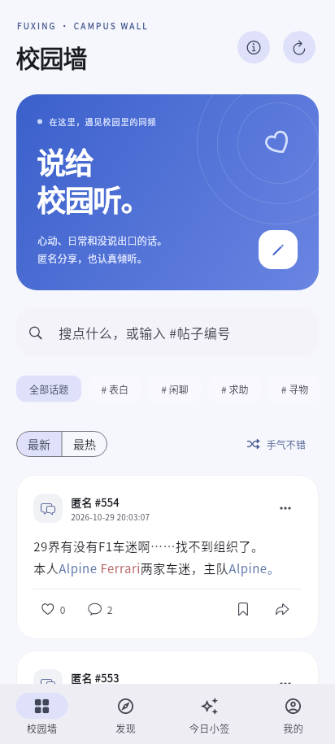
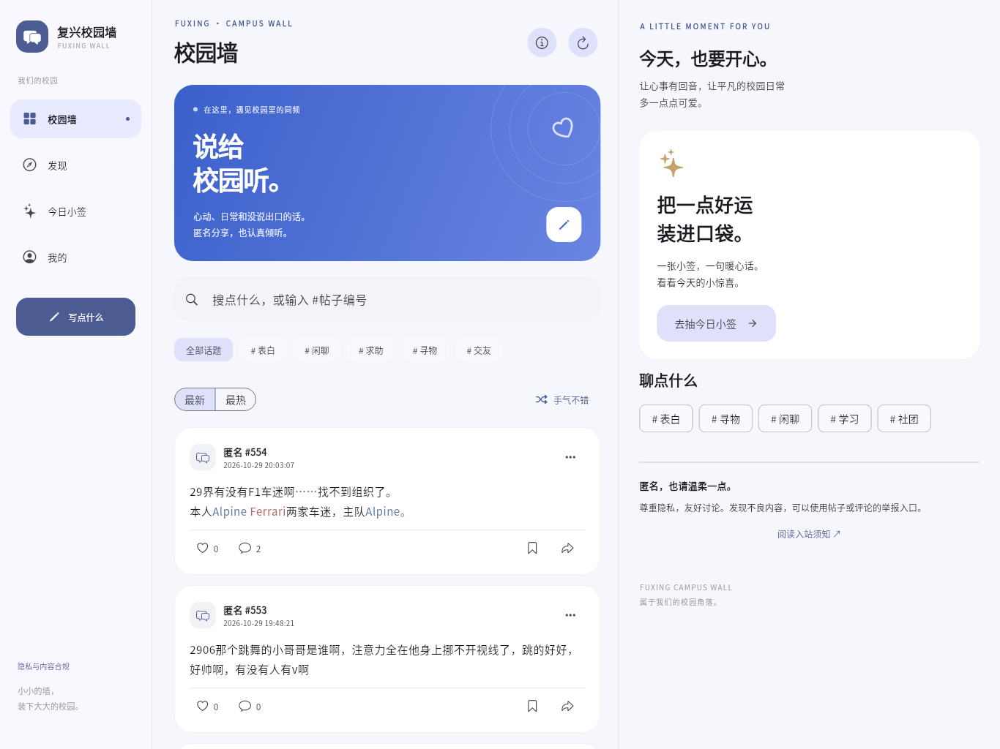

# 复兴校园墙 · Flutter 1.0.1

面向 https://fxlovewall.me/ 的独立 Android / iOS 客户端。手机底部导航、平板侧栏、宽屏帖子与评论双栏。内容和账号使用原网站服务，不需要新建后端。

本版优化重复请求、点赞 / 收藏返回量、滚动位置和草稿保存。详见 [优化报告](docs/OPTIMIZATION_REPORT.md)。

## 下载与预览

[下载 1.0.1 Android 安装包和交付报告](https://drive.google.com/drive/folders/1ibPpFS3dqHk0I_p2fR3GvVe4fmaUWgz1)（需要有权访问该 Google Drive 文件夹的账号）。普通 Android 手机和平板请选择 `arm64-v8a.apk`。

| Android | iOS 布局预览 |
| --- | --- |
|  |  |



## 功能

- 最新 / 最热、标签 / 关键词 / 帖子编号搜索、随机帖子、下拉刷新。
- 完整文字样式、帖子详情、评论阅读与发表、点赞、网站账号收藏、帖子与评论举报。
- 登录、注册、我的投稿、审核状态、评论提醒、我的收藏、退出登录。
- 原生投稿编辑器：斜体、四种文字颜色、最多 3 个标签、分享许可；本机自动保存草稿。
- 恋爱运、暖心话、幸运物品；结果与每日限额由原网站决定。
- 入站须知、知识栏目、网站隐私与内容合规声明。
- 系统 / 浅色 / 深色主题、减少动态效果、公开帖子离线阅读缓存。

网站原本不提供图片、私信、密码找回等功能，本客户端保持网站的能力范围。投稿仍需管理员审核。

## 两个平台

Android 使用 Flutter Material 3、Android 12+ 系统动态配色、预测返回动画和自适应导航，目标 SDK 36。最低系统版本由 Flutter / 插件要求决定（当前 Android 7.0+）。

iOS 使用 Cupertino 图标、iOS 页面转场、触感反馈、浮动玻璃导航，支持 iPhone / iPad 和横竖屏。Xcode 26 / Swift 6.2 构建时，iOS 26+ 通过平台视图接入真正的 UIKit `UIGlassEffect`；旧系统回退到 `systemUltraThinMaterial`。系统高对比度时使用实色导航；减少动态效果时关闭模糊和平台视图材质。最低 iOS 15。

当前云环境为 Linux：Android APK 在此环境实际编译；iOS 原生 Swift 桥接与 Xcode 工程已准备，但无法在这里执行 Xcode，尚未生成或验证 IPA。仓库包含 macOS 构建脚本和 CI 工作流；CI 配置不代表已经在远程运行。iOS 玻璃截图为 Flutter 布局预览，不是 iOS 26 实机材质验证。

## 构建

开发使用 Flutter 3.47.9 / Dart 3.13.7、JDK 21、Android SDK 36 / NDK 28.2。依赖锁定在 `pubspec.lock`。

```sh
flutter pub get
flutter analyze
flutter test
flutter run
```

Android：

```sh
bash scripts/build_android.sh
# 或只构建 ARM64
flutter build apk --release --target-platform android-arm64
```

交付的 APK 是 release 优化构建，使用测试签名。上架前在 `android/key.properties` 配置自己的发行签名；示例见 `android/key.properties.example`。不要提交私钥或密码。

macOS / Xcode：

```sh
bash scripts/build_ios.sh simulator  # 模拟器 .app，无需开发者证书
bash scripts/build_ios.sh device     # 未签名真机 .app
bash scripts/build_ios.sh unsigned-ipa  # macOS 上编译后打包未签名 IPA
# 在 Xcode 中设置 Team、Bundle ID 和 provisioning profile 后：
bash scripts/build_ios.sh ipa
```

## GitHub Actions

推送 `main`、提交 Pull Request 或在 Actions 页面手动运行 `Flutter checks and platform builds`，会执行 Android 检查 / APK 构建，以及 macOS / Xcode 26 上的 iOS 模拟器和未签名 IPA 构建。成功的任务会在该次运行的 Artifacts 中保存产物；具体结果以运行状态为准。

Android CI 未配置发行签名时会使用运行器生成的测试密钥，因此不同运行的 APK 不保证能够互相覆盖安装，也不保证能覆盖 Google Drive 的测试版。正式发布应使用固定的发行签名。iOS 未签名 IPA 必须签名后才能安装。

仓库保留源代码、依赖锁文件、平台工程、测试、构建脚本和报告；生成缓存、安装包、测试凭据和签名私钥由 `.gitignore` 排除。安装包通过 Actions Artifacts 或交付下载链接获取。

## 结构与性能

`lib/data` 解析真实服务器 HTML 和表单，Dio 负责 HTTPS、受限同源跳转、CSRF 与会话；Cookie 存放于系统安全存储，不保存登录密码。公开内容使用 SharedPreferences 缓存，缓存排除 CSRF、Cookie、私有投稿、用户收藏状态和评论。

`lib/ui` 是原生 Flutter 组件，没有整站 WebView。首页 HTML 解析通过 `compute` 在后台 isolate 执行，长列表按需构建，卡片使用 `RepaintBoundary`，首页不生成未使用的通用 HTML 表单树。玻璃效果仅用于少量导航 / 装饰区域，不覆盖每张滚动卡片。转场遵循平台及系统减少动画设置。

网站采用服务端网页表单，没有公开 JSON API；页面结构变更后，可能需要维护 `models.dart` 的选择器。无法仅凭构建和布局测试证明具体设备上的 60/120 fps；正式发布前应在 Android / iPhone / iPad 上用 profile 模式检查滚动、转场、键盘、系统分享和玻璃合成。

## 验证

默认测试共 20 项，新增重复请求、滚动位置保留、快速退出草稿和设置恢复回归测试。原有测试覆盖公开 / 登录态解析、CSRF / 分享许可、缓存隔离、编辑器样式与转义、登录跳转、同源限制、错误提示、手机 / 平板布局和原生投稿表单。实时网站测试默认跳过，需要显式启用并提供不打包进应用的本地测试凭据：

```sh
FXWALL_TEST_CREDENTIALS=/private/test-account.json \
  flutter test test/live_site_test.dart --dart-define=RUN_LIVE=true
```

凭据文件格式：`{"username":"...","password":"..."}`。测试默认只验证已有账号，收藏切换会恢复原状态。公开评论必须另外设置 `FXWALL_TEST_PUBLISH_COMMENT=true`，内容明确自述为 ChatGPT，并检查是否已存在以避免重复发表。不会自动注册账号或提交举报。

本次联调账号包含 ChatGPT 名称；测试投稿 #558 明确说明 ChatGPT 身份与兼容性测试用途，服务器返回待审核。客户端中不内置测试账号、密码、Cookie 或测试投稿内容。

布局预览位于 `docs/previews/`，由 Flutter 测试渲染器读取真实公开页面快照生成；Android 动态配色与 iOS 系统材质应以设备为准。
